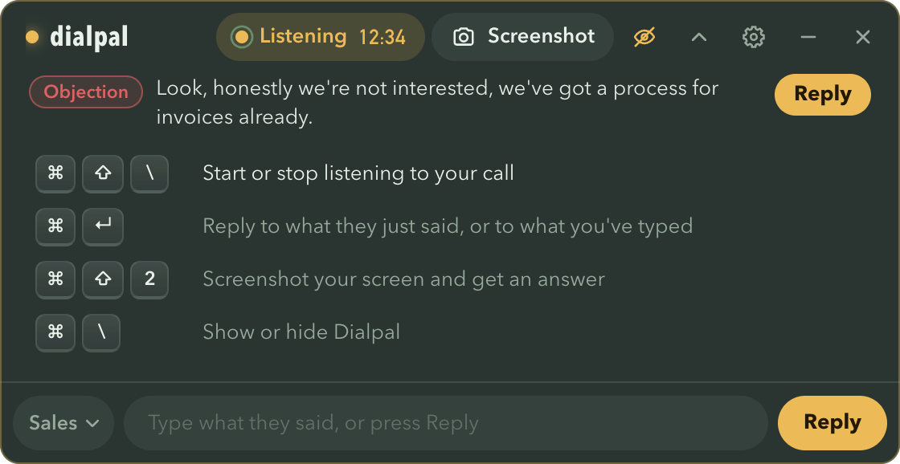

# Dialpal

A macOS overlay for sales calls. Dialpal listens to the prospect's side of the call, flags questions and objections as they're said, and shows the next line to say: one sentence, then a question to keep the call moving. Every product fact in a reply comes from your product brief. It works with Claude or any OpenAI-compatible model.

<p align="center">
  
  
</p>

## Features

- **Catches the pushback.** The other side of the call is transcribed on your Mac with NVIDIA's Parakeet speech model. Questions and common objections ("not interested", "send me an email", "we already use X", "no budget", "bad time", "who is this?") are flagged as they're said. Objections get a red tag.
- **Your next line in seconds.** Press **Reply** (⌘↵), or let Dialpal reply on its own once the prospect stops talking. The reply is one or two spoken sentences in large type, then a **Then ask** question.
- **Knows the call's stage.** Opener with a permission ask, pitch, discovery, objection, booking the meeting. Each stage gets a different kind of reply.
- **Never makes things up.** Prices, features, customers and results come only from your product brief. If something isn't in it, the reply says you'll follow up, and a note tells you what's missing.
- **Stays honest.** It never lies about who's calling or why, and never uses fake urgency. "Take me off your list" always gets a plain yes.
- **Keeps up with you.** If you said something else, press **I said something else** and the next reply builds on what you actually said.
- **Call notes.** Save a Markdown summary with the outcome (meeting booked or not, objections raised, next step), action items and the transcript.
- **Meeting mode** for ordinary calls: plain answers about the call and your screen.
- **Any model.** Anthropic (Opus, Sonnet, Haiku) or any OpenAI-compatible API: OpenAI, Gemini, OpenRouter, Groq, Mistral, or a local Ollama or LM Studio.

## The product brief

Settings › Sales › Product brief. Replies use only what's here, word for word. A good brief:

```
Product: what it is, in one line
Who it's for: ideal customer, roles, company size
Problem it solves:
Proof: customers, results with numbers
Pricing: what you can say on a call
Competitors: who they use today, how you differ
Meeting to book: e.g. 20-minute demo with an AE
Disclosure line (if your state or company requires it): e.g. "Heads up, this call is transcribed."
```

At the start of each call block, Dialpal asks whether to keep the same brief.

## Consent and recording laws

Dialpal transcribes the other side of the call live. In the US, federal law allows this with one party's consent, but California, Florida, Illinois, Washington and several other states require **every** party to consent. Many other countries have similar rules. Transcription may count as interception even if nothing is saved. Put a disclosure line in your brief and Dialpal includes it in the opener. Check with your own counsel for the places you call. This isn't legal advice.

Also follow do-not-call rules (the US National Do Not Call Registry and your company's own list). Dialpal doesn't check them.

## Requirements

- macOS 14.2 (Sonoma) or later, on Apple Silicon.
- An internet connection on first launch, for the speech model (about 660 MB, once).
- To build: Node.js 20 or later.
- An API key for Anthropic or an OpenAI-compatible service, or a local model server that needs no key.
- Your calls must play through the Mac (a browser dialer, Zoom Phone, Aircall, RingCentral or any softphone). Calls on your mobile phone aren't heard.

## Using Dialpal

1. Open Dialpal and follow setup: about you (optional), the speech model, your AI key, your product brief.
2. Press **Listen** (⌘⇧\\) when the call starts. The amber lamp next to the name lights up.
3. When the prospect says something, it appears under the bar, tagged **Prospect** or **Objection**. Press **Reply** (⌘↵), or turn on **Settings › Sales › Reply automatically**.
4. Read the big line aloud. Use **Then ask** if the moment fits.
5. After the call, **Save notes**.

| Shortcut | Action |
| --- | --- |
| ⌘⇧\\ | Start or stop listening |
| ⌘↵ | Reply to what they just said, or to what you typed |
| ⌘⇧2 | Screenshot your screen and answer |
| ⌘\\ | Show or hide Dialpal |
| ⌘⇧H | Hide from screen sharing |

## Privacy and data

- **Audio stays on your Mac.** Transcription runs locally. Only text (and screenshots you take) goes to your AI provider.
- **Your microphone is never recorded.** Dialpal hears only the Mac's audio, the prospect's side.
- **Keys** are stored in the macOS login keychain.
- Settings live in `~/Library/Application Support/Dialpal/`, logs in `~/Library/Logs/Dialpal/`, notes in `~/Documents/Dialpal/`.
- **Settings › General › Delete all Dialpal data** removes all of it.

## Build from source

```sh
npm install
npm run package   # builds and signs dist/Dialpal-darwin-arm64/Dialpal.app
npm start         # opens it
npm run dmg       # optional: dist/Dialpal-<version>-arm64.dmg
```

`npm run dev` runs from source, but macOS won't grant it screen recording, so screenshots only work in the packaged app.

## Development

```sh
npm test                        # unit tests and the UI click-through
DIALPAL_SKIP_UI=1 npm test      # skip the UI tests
node scripts/screenshots.mjs    # regenerate docs/images/
```

The UI tests launch the real app in test mode (`DIALPAL_TEST_DIR`) and drive it over the DevTools protocol, with a fake OpenAI-compatible server answering. Speech tests use small stand-in model files, so they never download the real model.

Dialpal started as a fork of Glance. The speech engine, overlay, providers and updater come from there.
