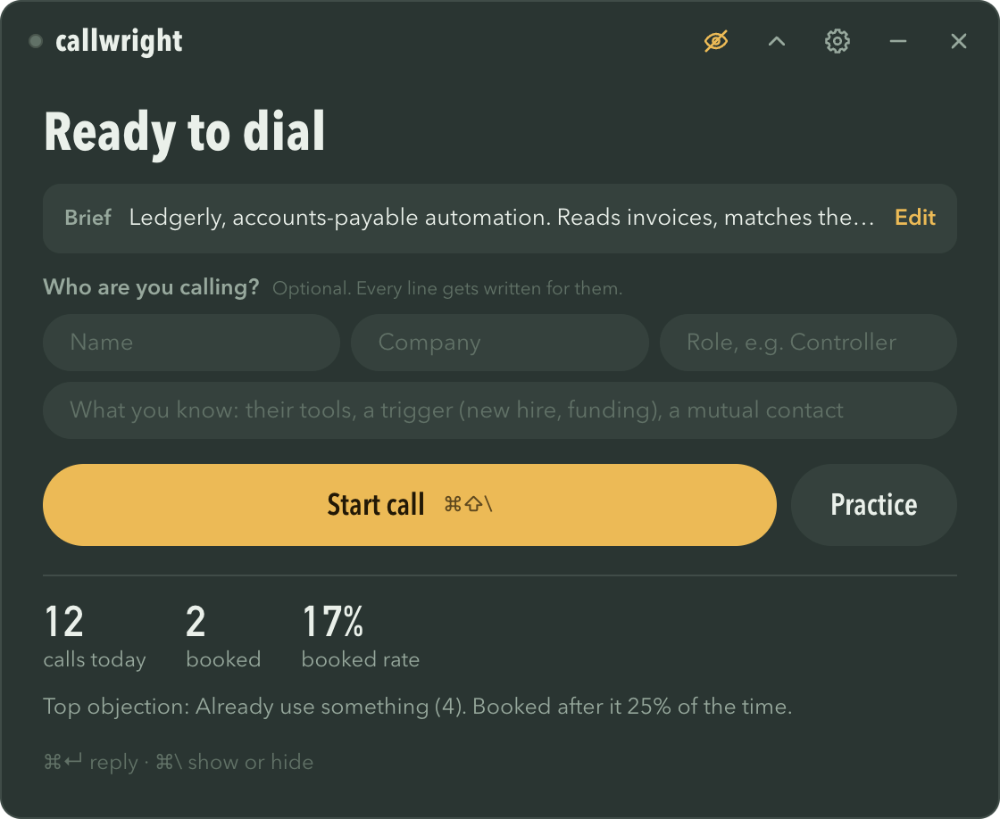
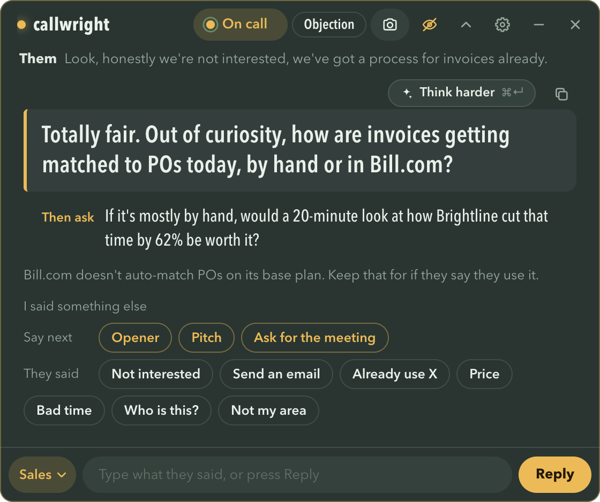
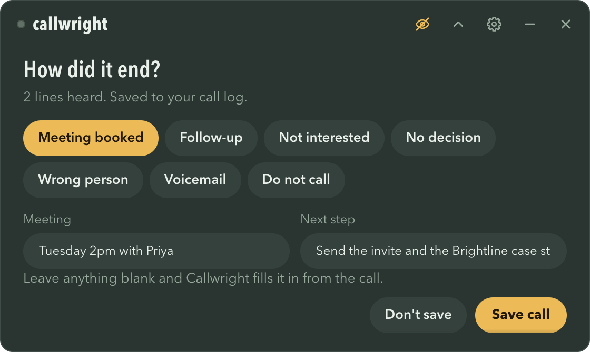

# Callwright

A macOS call console for cold calling. Before the call it shows your brief and today's numbers. During the call it listens to the prospect, flags objections, and shows the next line to say with the call's stage. After the call, one tap logs the outcome to your call log and HubSpot. Between calls, practice against an AI prospect and get scored. Every product fact in a reply comes from your product brief. It works with Claude or any OpenAI-compatible model.

<p align="center">
  
  
  
</p>

## Features

- **Catches the pushback.** The other side of the call is transcribed on your Mac with NVIDIA's Parakeet speech model. Questions and common objections ("not interested", "send me an email", "we already use X", "no budget", "bad time", "who is this?") are flagged as they're said. Objections get a red tag.
- **Your next line in seconds.** Press **Reply** (⌘↵), or let Callwright reply on its own once the prospect stops talking. The reply is one or two spoken sentences in large type, then a **Then ask** question.
- **You lead the call.** Start call shows your opener before the prospect says a word: who you are, what your company does for people like them, why you're calling, and a short permission ask. **Say next** gives your pitch and your ask for the meeting whenever you want them.
- **Written for the person you're calling.** Type their name, company, role and what you know (their tools, a new hire, funding) under **Who are you calling?** and every line uses it. It's cleared after each saved call.
- **Knows the call's stage.** Opener with a permission ask, pitch, discovery, objection, booking the meeting. Each stage gets a different kind of reply.
- **Never makes things up.** Prices, features, customers and results come only from your product brief. If something isn't in it, the reply says you'll follow up, and a note tells you what's missing.
- **Stays honest.** It never lies about who's calling or why, and never uses fake urgency. "Take me off your list" always gets a plain yes.
- **Keeps up with you.** If you said something else, press **I said something else** and the next reply builds on what you actually said.
- **One-tap objections.** If the transcript misses it, tap what they said (Not interested, Send an email, Already use X, Price, Bad time, Who is this?, Not my area) and get the reply.
- **Wrap-up in seconds.** When the call ends, pick the outcome, add the meeting time and next step (or leave them blank and Callwright reads them from the call), and **Save call**. Callwright is ready for the next dial.
- **Call log.** Every saved call adds a row to `Documents/Callwright/calls.csv` (import it into any CRM) and a notes file with a summary and the transcript.
- **HubSpot.** Optionally log each real call to HubSpot as a call with the outcome, objections and next step, on the contact when their email came up.
- **Stats.** Calls, meetings booked, booked rate, the objections you hear most, how often you handle each one and how often a meeting follows it.
- **Practice calls.** Four AI prospects (busy, skeptical, curious, a gatekeeper) pick up and talk back with a Mac voice. Talk into your mic or type, press ⌘↵ for a hint, and end the call to get a scorecard: opener, discovery, objections and close, what to work on, and a better version of your weakest line. Practice is kept out of your real stats and never sent to HubSpot.
- **Meeting mode** for ordinary calls: plain answers about the call and your screen.
- **Any model.** Anthropic (Opus, Sonnet, Haiku) or any OpenAI-compatible API: OpenAI, Gemini, OpenRouter, Groq, Mistral, or a local Ollama or LM Studio.

## The product brief

Home › Brief (or Settings › Calls › Product brief). Replies use only what's here, word for word. A good brief:

```
Product: what it is, in one line
Who it's for: ideal customer, roles, company size
Problem it solves:
Proof: customers, results with numbers
Pricing: what you can say on a call
Competitors: who they use today, how you differ
Meeting to book: e.g. 20-minute demo with an AE
Disclosure line (if your state or company requires it): e.g. "Heads up, this call is transcribed."
```

At the start of each call block, Callwright asks whether to keep the same brief.

Add a **Lead source** line (how you found them) so "how did you get my number?" gets an honest answer, and your own **Opener** and **Pitch** if you have a script you like: Callwright uses them nearly word for word.

## Consent and recording laws

Callwright transcribes the other side of the call live. In the US, federal law allows this with one party's consent, but California, Florida, Illinois, Washington and several other states require **every** party to consent. Many other countries have similar rules. Transcription may count as interception even if nothing is saved. Put a disclosure line in your brief and Callwright includes it in the opener. Check with your own counsel for the places you call. This isn't legal advice.

Also follow do-not-call rules (the US National Do Not Call Registry and your company's own list). Callwright doesn't check them.

## Requirements

- macOS 14.2 (Sonoma) or later, on Apple Silicon.
- An internet connection on first launch, for the speech model (about 660 MB, once).
- To build: Node.js 20 or later.
- An API key for Anthropic or an OpenAI-compatible service, or a local model server that needs no key.
- Your calls must play through the Mac (a browser dialer, Zoom Phone, Aircall, RingCentral or any softphone). Calls on your mobile phone aren't heard.

## Using Callwright

1. Open Callwright and follow setup: about you (optional), the speech model, your AI key, your product brief.
2. Press **Start call** (⌘⇧\\) when the call connects. The amber lamp lights up and the header shows the time and the call's stage.
3. When the prospect says something, it appears at the top, tagged **Prospect** or **Objection**. Press **Reply** (⌘↵), turn on **Settings › Calls › Reply automatically**, or tap the objection they raised.
4. Read the big line aloud. Use **Then ask** if the moment fits.
5. Press **End call**, pick how it ended, and **Save call**.

To practise, press **Practice** on the home screen, pick who picks up, and start the call. Microphone access is asked for the first time; it's only ever used in practice.

| Shortcut | Action |
| --- | --- |
| ⌘⇧\\ | Start or end a call |
| ⌘↵ | Reply to what they just said, or to what you typed |
| ⌘⇧2 | Screenshot your screen and answer |
| ⌘\\ | Show or hide Callwright |
| ⌘⇧H | Hide from screen sharing |

## Privacy and data

- **Audio stays on your Mac.** Transcription runs locally. Only text (and screenshots you take) goes to your AI provider.
- **Your microphone is never used on real calls.** Callwright hears only the Mac's audio, the prospect's side. Practice calls use the mic, transcribed on your Mac like the call audio.
- **HubSpot** gets only the call record (summary, outcome, objections, next step), never audio or the transcript. The token is kept in your keychain.
- **Keys** are stored in the macOS login keychain.
- Settings live in `~/Library/Application Support/Callwright/`, logs in `~/Library/Logs/Callwright/`, notes in `~/Documents/Callwright/`.
- **Settings › General › Delete all Callwright data** removes all of it.

## Build from source

```sh
npm install
npm run package   # builds and signs dist/Callwright-darwin-arm64/Callwright.app
npm start         # opens it
npm run dmg       # optional: dist/Callwright-<version>-arm64.dmg
```

`npm run dev` runs from source, but macOS won't grant it screen recording, so screenshots only work in the packaged app.

## Development

```sh
npm test                        # unit tests and the UI click-through
CALLWRIGHT_SKIP_UI=1 npm test      # skip the UI tests
node scripts/screenshots.mjs    # regenerate docs/images/
ANTHROPIC_API_KEY=… node test/sales-eval.js   # real-model check of Sales replies
```

`scripts/simulate-call.mjs [busy|skeptical|curious|gatekeeper] [turns]` runs a whole call through the real pipeline with no phone or mic: an AI prospect speaks each line with a Mac voice, Parakeet transcribes it, Callwright's detector tags questions and objections, and the Sales reply is what the rep "says" next. It ends with the call record and a scorecard, and reports the speech word error rate. Needs the speech model (open Callwright once) and `ANTHROPIC_API_KEY`.

`test/sales-eval.js` runs 14 call moments (opener, pitch, each common objection, a price question, a fact not in the brief, the meeting ask, do-not-call) against a real model. It checks each reply against the rules: a short spoken line, numbers only from the brief, a forward question, two time options, no invented integrations, do-not-call honoured. It also asks the model, playing a busy finance buyer, to score each line 1-10 for how likely it is to get a meeting. `EVAL_ONLY="opener|budget"` runs a subset; `EVAL_PROVIDER=openai EVAL_BASE_URL=… OPENAI_API_KEY=…` targets another provider. Read the replies as well: the checks can't judge everything.

The UI tests launch the real app in test mode (`CALLWRIGHT_TEST_DIR`) and drive it over the DevTools protocol, with a fake OpenAI-compatible server answering. Speech tests use small stand-in model files, so they never download the real model.

Callwright started as a fork of Glance. The speech engine, overlay, providers and updater come from there.
